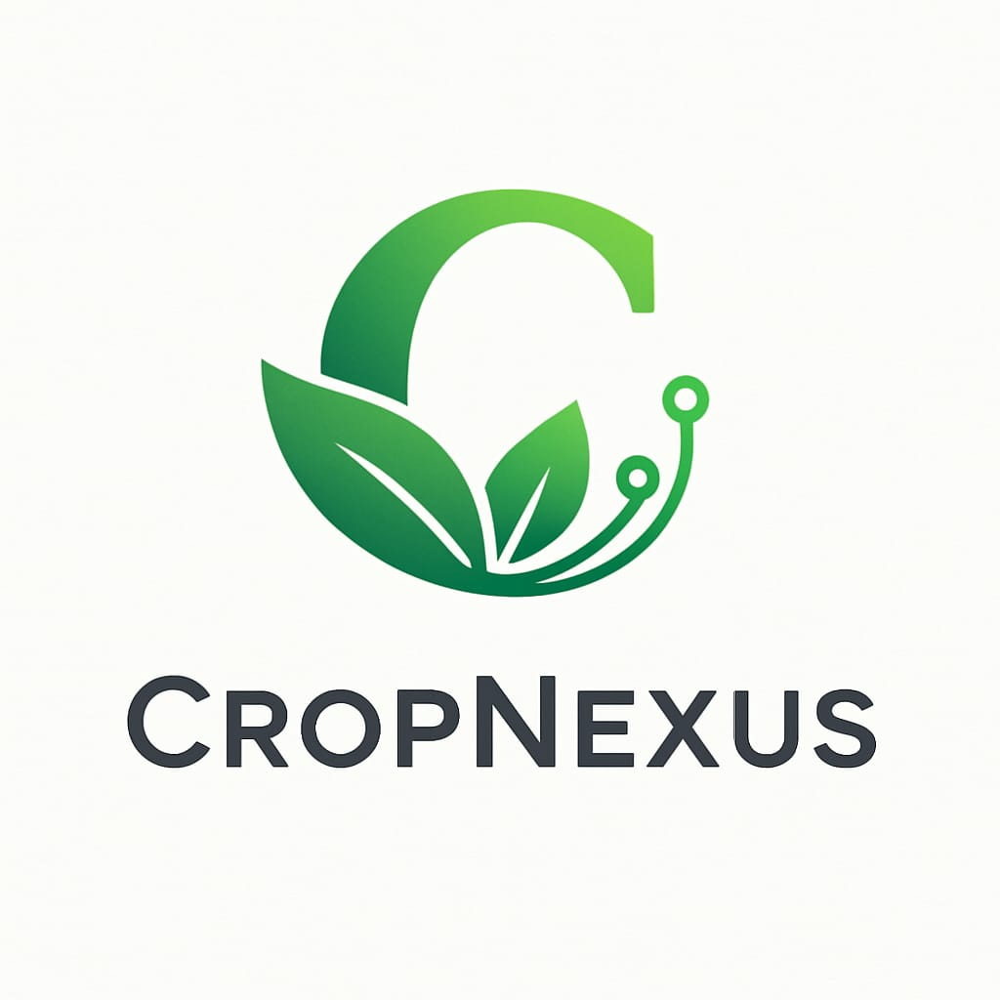
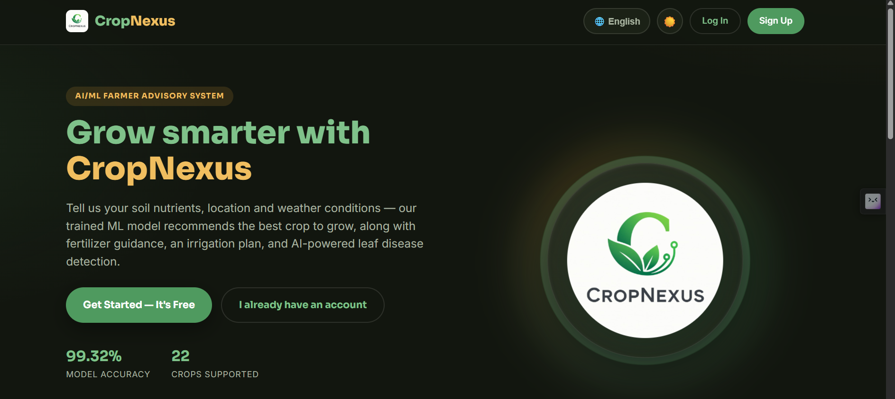
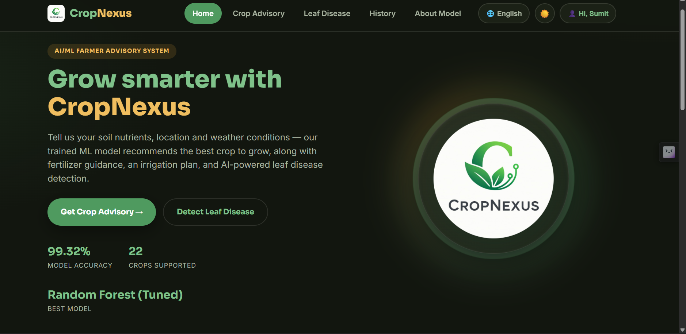
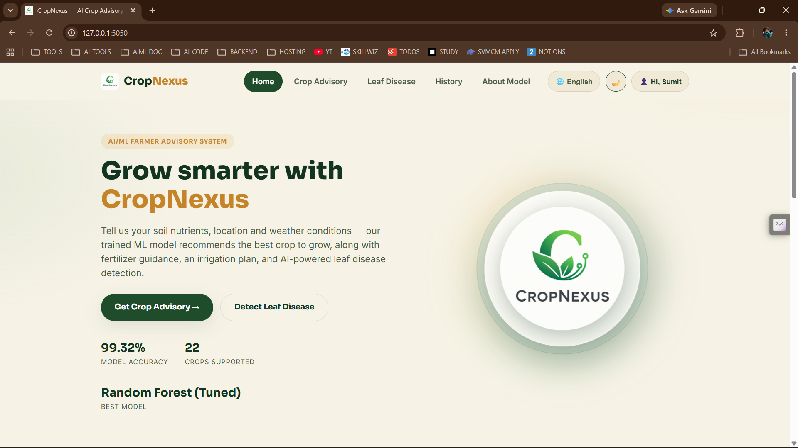
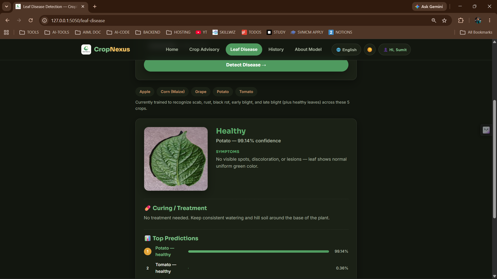

<!--  -->

---

## 📸 Screenshots

| | |
|---|---|
| **Landing**  | **Feature section**  |
| **Features menu**  | **Sign-up (age-range guide)**  |
| **Home (signed in)**  | **Dark mode**  |
| **Crop Calendar**  | **Products**  |
| **Soil Health**  | **Water Management**  |
| **Plant Disease**  | **Mobile landing**  |
| **Mobile Features menu**  | **Mobile, signed in**  |

---

## 📋 Table of Contents

[Overview](#-overview) · [Tech Stack](#-tech-stack) · [Features](#-features) · [Security](#-security) · [Model Results](#-model-results) · [Limitations](#-limitations)

---

## 🌾 Overview

CropNexus helps a farmer decide **what to grow**, check a **sick leaf**, view **weather**, plan **irrigation**, keep a **task calendar** and find **government schemes**, all in one app.

---

## 🧰 Tech Stack

| Layer | Technologies |
|---|---|
| **Frontend** |  |
| **Backend** |  |
| **AI / ML** |  |

---

## ✨ Features

| Feature | Login | What it does | Powered by |
|---|:---:|---|---|
| 🌱 **Crop Prediction** | ✔ | Top-3 crops from N-P-K, pH and weather, with fertilizer and irrigation tips | Random Forest (30 crops) |
| 🍃 **Plant Disease Detector** | ✔ | Disease from a leaf photo, with symptoms, treatment and low-confidence warning | TensorFlow CNN (10 classes) |
| ☁️ **Live Weather** | – | Current conditions, 7-day forecast and farm alerts | Open-Meteo |
| 💧 **Water Management** | – | 7-day irrigation plan (14 crops, 6 soils, 3 methods), save days to calendar | FAO-56 + Open-Meteo |
| 📅 **Crop Calendar** | ✔ | Priority tasks, calendar and list views, filters, overdue alerts, edit and reschedule | MongoDB |
| 🪱 **Soil Health** | ✔ | Soil-test ratings (rule-based) and experimental soil-type photo guess | Rules + CNN |
| 🛒 **Products** | – | 30 hand-checked products with seller links, search and filters | `products.json` |
| 🏛️ **Farming Resources** | – | 18 government schemes with official links, plus agriculture news | `schemes.json` + RSS |
| 📬 **About / Contact** | – | Transparent model vs API vs rules table, spam-protected contact form | – |

**Also included:** 6-step sign-up, password reset by email, feedback with 1–5 stars, live community stats (landing and Home only), profile avatars, **9 languages**, light/dark theme, reduced-motion support, glass navbar, scroll reveals and count-up numbers.

---

## 🛡️ Security

- 🔑 Passwords hashed with **bcrypt (cost 12)**
- 🍪 **HttpOnly, SameSite=Strict** JWT cookie plus CSRF header
- 🚪 Logout and password reset instantly invalidate old sessions
- ⏱️ 3-minute login cooldown, 15-minute lock after 5 wrong passwords
- 🔗 Reset links: random, hashed, single-use, 15-minute expiry
- 🧱 `helmet`, zod validation, 12 MB upload limit, per-IP rate limits, contact honeypot

---

## 📊 Model Results

| Model | Data | Test accuracy |
|---|---|---|
| **Crop (real-data crops)** | Kaggle Crop Recommendation, 22 crops | **99.32 %** |
| **Crop (synthetic crops)** | 8 crops from author-written ranges | 100 % (by construction, not field data) |
| **Leaf disease** | PlantVillage, 10 classes | **91.96 %** |
| **Soil photo** | Phantom-fs, 7 soil types | 30.8 % (experimental) |

---

## ⚠️ Limitations

- 🧪 8 crops use **synthetic data** and need agronomist review before real use.
- 🪱 Soil photo model is **weak** (30.8 %) and the dataset is non-commercial; it never reads nutrients, pH or salinity from a photo.
- 🍃 Leaf model covers 5 crops from lab-style photos; field photos will score lower.
- 🪪 No OTP or identity verification at sign-up.
- 🌐 New feature pages are English-only; other languages fall back to English there.
- 🌦️ Water plans and weather alerts are estimates, not sensor measurements.

> CropNexus is a decision-support tool. Confirm important decisions with a local agriculture officer.

